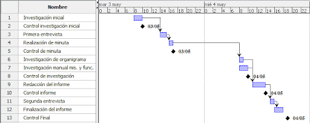
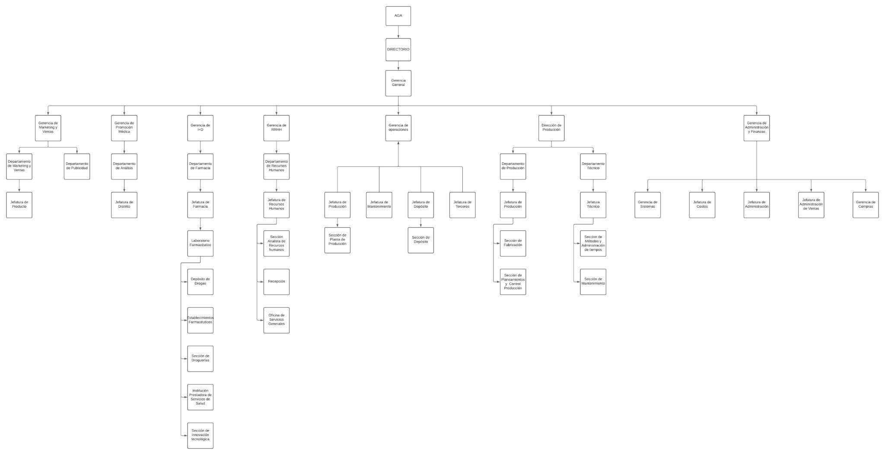

# Universidad Tecnológica Nacional - Facultad Regional Buenos Aires
## Análisis de Sistemas - 2022

* **Curso:** K2102
* **Jefe de Cátedra:** Darío Piccirilli
* **Profesor:** Diego Schmidt
* **Ayudantes:** Rodrigo Putrino, Luciana Bertolani

---

### Trabajo Práctico Integrador N°1: Estudio Preliminar

* **Fecha Estipulada de 1° Entrega:** -
* **Fecha Real de Entrega:** -
* **N° de Versión de la Entrega:** 1
* **Grupo N°4**

| Alumno | Legajo |
| :--- | :--- |
| LUCAS EIKI ARAKAKI JAHANA | 1722499 |
| JOAQUÍN CARRIQUIRY CASTRO | 2026703 |
| PATRICIO LIONEL GARCÍA | 2036563 |
| MELINA PAOLA LOZA FLORES | 1687645 |

---

## ÍNDICE
1. [Objetivo del documento](#objetivo-del-documento)
2. [Alcance de la etapa](#alcance-de-la-etapa)
3. [Planificación](#planificación)
   * [Diagrama de Gantt](#diagrama-de-gantt)
   * [Tabla de especificaciones](#tabla-de-especificaciones)
4. [Desarrollo](#desarrollo)
5. [Conclusiones](#conclusiones)
6. [Anexos](#anexos)
7. [Glosario](#glosario)

---

## Objetivo del documento 
El presente documento pretende representar el resultado del Estudio Preliminar realizado en la Organización MEGALABS durante el mes de abril de 2022 en el contexto del proyecto de desarrollo del Sistema de registro de las visitas por parte de los visitadores médicos al laboratorio.

---

## Alcance de la etapa 
En esta primera etapa nos limitaremos a un estudio inicial de la organización y, por lo tanto, no ampliaremos sobre sus operaciones diarias. Por ello, la información que buscaremos obtener será principalmente de carácter general con el fin de comprender su propósito y familiarizarnos con su entorno, además de un pequeño acercamiento a la problemática y el objetivo de mandato que estudiaremos en las etapas posteriores. 

Se llevará a cabo una entrevista al Gerente General y una investigación exhaustiva de los documentos centrales de la compañía para obtener más información de la organización en sí misma y de la problemática. 

---

## Planificación
Para esta primera etapa, se comenzará con una sesión de investigación inicial de la organización, donde se buscará y documentará información pública acerca de la empresa. Se continuará con una primera entrevista al Gerente General, al cual le consultaremos ciertos aspectos relacionados con la organización y la problemática en cuestión, y a su vez le solicitaremos la documentación central pertinente. Posteriormente, se realizará una investigación de dichos documentos y un estudio de las respuestas del entrevistado, registradas en la Minuta. Luego se llevará a cabo la redacción de un informe, y al finalizarlo se decidirá si es necesaria una breve segunda entrevista para su compleción. En caso de que sea así, se programará para la instancia más pronta posible con el fin de finalizar y entregar el informe sin ningún tipo de demora.

La entrevista a realizar al Gerente General se llevará a cabo en el laboratorio con un esquema no estructurado, en la que se tratarán temas en relación con la organización, sus objetivos, sus áreas y los roles de éstas dentro de la misma. Además, se le preguntará sobre la problemática en cuestión, los sectores afectados y las supuestas causas.

### Diagrama de Gantt

### Tabla de especificaciones

| Código | Nombre | Duración | Inicio | Terminado | Predecesores |
| :---: | :--- | :---: | :---: | :---: | :---: |
| 1 | Investigación inicial | 2:00 | 03/05/22 08:00 | 03/05/22 10:00 | - |
| 2 | Control investigación inicial | 0:00 | 03/05/22 10:00 | 03/05/22 10:00 | - |
| 3 | Primera entrevista | 1:30 | 03/05/22 14:00 | 03/05/22 15:30 | 1 |
| 4 | Realización de minuta | 0:30 | 03/05/22 15:30 | 03/05/22 16:00 | 3 |
| 5 | Control de Minuta | 0:00 | 03/05/22 16:00 | 03/05/22 16:00 | - |
| 6 | Investigación de organigrama | 1:00 | 04/05/22 08:00 | 04/05/22 09:00 | 4 |
| 7 | Investigación de manual de misiones y funciones | 2:00 | 04/05/22 08:00 | 04/05/22 10:00 | - |
| 8 | Control de investigación | 0:00 | 04/05/22 11:00 | 04/05/22 11:00 | - |
| 9 | Redacción del informe | 3:00 | 04/05/22 11:00 | 04/05/22 14:00 | 6; 7 |
| 10 | Control de informe | 0:00 | 04/05/22 14:00 | 04/05/22 14:00 | - |
| 11 | Segunda entrevista | 1:00 | 04/05/22 16:00 | 04/05/22 17:00 | 9 |
| 12 | Finalización del informe | 2:00 | 04/05/22 16:00 | 04/05/22 18:00 | 11 |
| 13 | Control Final | 0:00 | 04/05/22 19:00 | 04/05/22 19:00 | - |

---

## Desarrollo 

Para la realización de esta etapa, el único individuo de la organización involucrado es el Gerente General, Ruperto Mankini. 

La organización a ser estudiada se denomina **Megalabs S.A.**, un laboratorio que inició sus actividades en Uruguay en el año 1961 bajo el nombre de Roemmers S.A. Luego de medio siglo de trayectoria en el país, es la empresa líder de la industria farmacéutica desde 1991. Posteriormente, en el año 2021, cambió su razón societaria a Megalabs Uruguay S.A. Esta organización basa su estrategia en la constante innovación para ofrecer soluciones a las necesidades de los médicos y pacientes.

Esta organización tiene como objetivo principal la resolución de los problemas que aquejan a la salud de los humanos, el bienestar de la comunidad y el cuidado del medio ambiente, a través de la investigación, el desarrollo y la producción de fármacos o medicamentos. A su vez, busca establecer y mantener una relación de respeto y compromiso entre médicos, farmacias, clientes y proveedores.

La organización posee un sitio web global y otros destinados a cada país individualmente:
* **Global:** [https://megalabs.global/](https://megalabs.global/)
* **Argentina:** [https://megalabs.com.ar/](https://megalabs.com.ar/)

La empresa cuenta con una casa matriz en Uruguay ubicada en el Parque de las Ciencias, integrada por una planta de producción, un centro de I+D, un sector de control de calidad y un centro corporativo desde donde se realizan tareas en áreas administrativas, financieras y tecnológicas que impactan en el funcionamiento de la compañía en toda Latinoamérica. 

El alcance geográfico de la organización se extiende a los siguientes países de Latinoamérica: Argentina, Brasil, Perú, México, Chile, Colombia, Bolivia, República Dominicana, Paraguay, Ecuador y Venezuela. En Argentina, la compañía dispone de una sede con oficinas ubicadas en Vuelta de Obligado 2775 y una planta elaboradora en Cuba 2760, que a su vez funciona como centro de I+D.

La organización apunta al mercado farmacéutico. La principal actividad es la investigación, desarrollo y comercialización de productos químicos medicinales de uso humano para el tratamiento o prevención de enfermedades. El centro de I+D ubicado en Argentina hace hincapié en la investigación y el desarrollo de productos biofarmacéuticos para la salud humana, realizando exportaciones de proteínas recombinantes con el propósito de registrar nuevos productos de calidad en mercados exigentes.

La organización cuenta con más de 8.000 colaboradores, 17 plantas de producción, 7 centros de I+D y más de 80 proyectos al año a nivel regional. Aproximadamente un 24% de los médicos prescriben sus productos, alcanzando un millón de prescripciones mensuales. En Argentina, la compañía dispone de 203 empleados y 121 clientes (farmacias).

A nivel global comercializa más de 1.800 productos. En Argentina comercializa 202 productos de las áreas de neurociencias, ginecología + línea general, dermatología y OTC.

### Estructura Organizativa

La empresa está compuesta por 7 áreas principales:
1. **Gerencia de Marketing:** Gestión del uso de recursos para la promoción y venta, dirección estratégica de nuevos mercados y optimización del portafolio.
2. **Gerencia de Promoción Médica:** Cumplimiento de objetivos comerciales, promocionales, de capacitación y de comunicación externa.
3. **Gerencia de RRHH:** Administración del personal, cumplimiento de la legislación laboral y mantenimiento del clima laboral.
4. **Gerencia de Operaciones:** Dividida en Depósito, Mantenimiento, Producción, Terceros y Control de Calidad.
5. **Gerencia de I+D:** Coordinación de la innovación de nuevos productos, procedimientos y materiales.
6. **Gerencia de Administración y Finanzas:** Dirección económica, mitigación de riesgos y optimización de recursos.
7. **Dirección Técnica:** Garantía de normas de correcta fabricación, aprobación de procedimientos y documentación técnica/legal.

### Problemática e Identificación del Objetivo

La problemática que se pretende resolver refiere a un procedimiento que consume mucho tiempo y recursos en el área de Sistemas de la empresa. 

El proceso consiste en el registro de las visitas de los visitadores médicos al laboratorio. Hasta 1999 se realizaba en fichas preimpresas a mano y luego se implementaron planillas de Excel. A pesar de los avances, la tarea continúa efectuándose de forma manual, insumiendo un tiempo considerable del equipo de Sistemas y Administración.

**Áreas afectadas:**
* **Administración y Ventas:** De la cual depende Sistemas, encargada de registrar las visitas.
* **Promoción Médica:** Responsable de la planificación y desarrollo de las visitas.
* **RRHH:** Encargada de seleccionar y capacitar al personal involucrado.

**Objetivo de Mandato:** Automatizar y optimizar el proceso de registro de visitas médicas para lograr una reducción significativa de costos y una mayor velocidad de ejecución.

---

## Conclusiones
En esta etapa se ha llevado a cabo un estudio preliminar de la organización Megalabs y la problemática del registro manual de visitas. 

Lo más probable es que se requiera la implementación de un nuevo sistema (como complemento o sustituto al actual). Si bien las hojas de cálculo no permiten realizar esta tarea de forma completamente automática por sí solas, podrían integrarse con macros o con sistemas externos para capturar los datos de los visitadores.

Se recomienda avanzar hacia la siguiente fase de **relevamiento de información detallada** sobre la problemática y las áreas afectadas.

---

## Anexos 

### Anexo 1 - Folleto Promocional

---

### Anexo 2 - Organigrama de la Organización

---

## Glosario

* **I+D:** Investigación y Desarrollo. Aplicado a departamentos enfocados en la creación o mejora de productos mediante investigación científica.
* **RR.HH.:** Recursos Humanos. Área encargada de seleccionar, contratar, formar, emplear y retener al personal de la organización.
* **Visitadores Médicos:** Profesionales encargados de visitar consultorios médicos para promocionar productos farmacéuticos o reforzar la permanencia de los ya comercializados.
