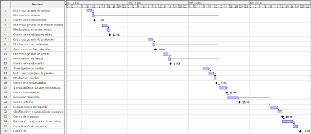
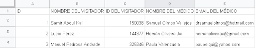
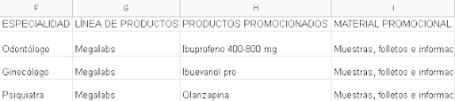
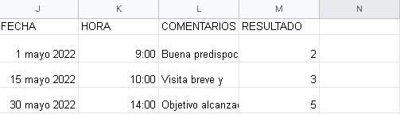
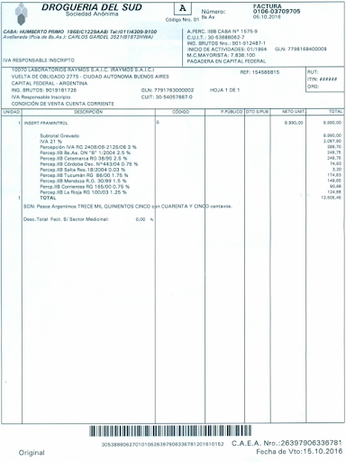

# Universidad Tecnológica Nacional - Facultad Regional Buenos Aires
## Análisis de Sistemas - 2022

* **Curso:** K2102
* **Jefe de Cátedra:** Darío Piccirilli
* **Profesor:** Diego Schmidt
* **Ayudantes:** Rodrigo Putrino, Luciana Bertolani

---

### Trabajo Práctico Integrador N°2: Relevamiento

* **Fecha Estipulada de 1° Entrega:** 28/06
* **Fecha Real de Entrega:** 27/06
* **N° de Versión de la Entrega:** 1
* **Grupo N°4**

| Alumno | Legajo |
| :--- | :--- |
| LUCAS EIKI ARAKAKI JAHANA | 1722499 |
| JOAQUÍN CARRIQUIRY CASTRO | 2026703 |
| DANIEL COLQUI HUANCA | 1768967 |
| PATRICIO LIONEL GARCÍA | 2036563 |
| MELINA PAOLA LOZA FLORES | 1687645 |

---

## ÍNDICE 
1. [Objetivo del documento](#objetivo-del-documento)
2. [Alcance de la etapa](#alcance-de-la-etapa)
3. [Planificación](#planificación)
4. [Desarrollo](#desarrollo)
   * [Objetivo](#objetivo)
   * [Procesos a relevar](#procesos-a-relevar)
     * [Proceso N°1: Registro en planillas de las visitas médicas](#proceso-n1-registro-en-planillas-de-las-visitas-médicas)
     * [Proceso N°2: Visita médica](#proceso-n2-visita-médica)
     * [Proceso N°3: Capacitación del visitador médico](#proceso-n3-capacitación-del-visitador-médico)
     * [Proceso N°4: Planificación de Producción](#proceso-n4-planificación-de-producción)
     * [Proceso N°5: Ventas a Droguerías](#proceso-n5-ventas-a-droguerías)
5. [Conclusiones](#conclusiones)
6. [Anexo](#anexo)
7. [Glosario](#glosario)

---

## Objetivo del documento 
El presente documento pretende representar el resultado del Relevamiento realizado en la Organización MEGALABS durante el mes de mayo de 2022 en el contexto del proyecto de desarrollo del Sistema de registro de las visitas por parte de los Visitadores Médicos al laboratorio.

---

## Alcance de la etapa
En esta etapa de Relevamiento se dará lugar a la búsqueda y obtención de información detallada sobre la problemática y las consecuentes áreas afectadas por esta. Este estudio es un análisis exhaustivo de los procesos de la organización que se ven relacionados con estas áreas, y posee el objetivo de localizar el origen o causa de la problemática además de oportunidades de mejoras, ya sean relacionadas o no con la problemática.

Un buen Relevamiento nos brindará una óptima base para la realización de la siguiente etapa en la cual se comenzarán a evaluar posibles soluciones con respecto a la información recabada en esta misma etapa.

---

## Planificación
En esta segunda etapa de relevamiento comenzaremos entrevistando a los gerentes de los sectores de sistemas y de promoción médica. Aquí tendremos tres objetivos principales:
1. Conseguir un entendimiento en detalle de los procesos involucrados con las visitas médicas.
2. Lograr localizar los distintos procesos que consideremos necesarios relevar.
3. Determinar toda documentación de importancia que se relaciona con las visitas.

Finalizadas estas primeras entrevistas, procederemos con otras a los sectores que no se involucran directamente con el proceso de la problemática pero se ven afectadas por estas: producción y ventas. Nuestro objetivo con estas entrevistas será entender cómo se ven afectadas estas áreas por el proceso.

Una vez terminado este análisis detallado del proceso de las visitas, continuaremos con una investigación de las planillas de los visitadores médicos para luego realizar una última entrevista con el encargado de llenar dichas planillas, ya que este nos brindará la visión del proceso de un usuario del sistema.

Terminadas todas estas entrevistas, evaluaremos toda la información recolectada para terminar de definir cada proceso que juzguemos necesario relevar y, de ser necesario, determinar otras entrevistas a realizar o documentación a solicitar, para luego finalizar con la redacción del informe.

### Diagrama de Gantt

### Tabla de especificaciones

| Código | Nombre | Duración | Inicio | Terminado | Predecesores |
| :---: | :--- | :---: | :---: | :---: | :---: |
| 1 | Entrevista gerente de sistemas | 2:00 | 13/06/22 08:00 | 13/06/22 10:00 | - |
| 2 | Minuta entrevista gerente de sistemas | 0:30 | 13/06/22 10:00 | 13/06/22 10:30 | 1 |
| 3 | Control entrevista gerente de sistemas | 0:00 | 13/06/22 10:30 | 13/06/22 10:30 | - |
| 4 | Entrevista gerente de promoción médica | 2:00 | 13/06/22 14:00 | 13/06/22 16:00 | - |
| 5 | Minuta entrevista gerente de promoción médica | 0:30 | 13/06/22 16:00 | 13/06/22 16:30 | 4 |
| 6 | Control entrevista promoción médica | 0:00 | 13/06/22 16:30 | 13/06/22 16:30 | - |
| 7 | Entrevista gerente de producción | 2:00 | 14/06/22 08:00 | 14/06/22 10:00 | - |
| 8 | Redacción minuta entrevista gerente de producción | 0:30 | 14/06/22 10:00 | 14/06/22 10:30 | 7 |
| 9 | Control entrevista gerente de producción | 0:00 | 14/06/22 10:30 | 14/06/22 10:30 | - |
| 10 | Entrevista gerente de ventas | 2:00 | 14/06/22 14:00 | 14/06/22 16:00 | - |
| 11 | Redacción minuta entrevista gerente de ventas | 0:30 | 14/06/22 16:00 | 14/06/22 16:30 | 10 |
| 12 | Control entrevista gerente de ventas | 0:00 | 14/06/22 16:30 | 14/06/22 16:30 | - |
| 13 | Investigación planillas de registro de visitas médicas | 2:00 | 15/06/22 06:00 | 15/06/22 08:00 | - |
| 14 | Entrevista encargado de registro de visitas médicas | 2:00 | 15/06/22 08:00 | 15/06/22 10:00 | 13 |
| 15 | Minuta entrevista encargado de registro de visitas médicas | 0:30 | 15/06/22 10:00 | 15/06/22 10:30 | 14 |
| 16 | Control entrevista encargado de registro de visitas médicas | 0:00 | 15/06/22 11:00 | 15/06/22 11:00 | - |
| 17 | Investigación de documentos/minutas | 3:00 | 15/06/22 12:00 | 15/06/22 15:00 | 2;5;8;11;15 |
| 18 | Control investigación | 0:00 | 15/06/22 15:00 | 15/06/22 15:00 | - |
| 19 | Redacción de informe | 5:00 | 15/06/22 15:00 | 15/06/22 20:00 | 17 |
| 20 | Control de informe | 0:00 | 15/06/22 20:00 | 15/06/22 20:00 | - |
| 21 | Descubrimiento de requisitos | 3:00 | 16/06/22 08:00 | 16/06/22 11:00 | 19 |
| 22 | Clasificación y organización de requisitos | 2:00 | 16/06/22 11:00 | 16/06/22 13:00 | 21 |
| 23 | Control de requisitos | 0:00 | 16/06/22 13:00 | 16/06/22 13:00 | - |
| 24 | Priorización y negociación de requisitos | 4:00 | 16/06/22 13:00 | 16/06/22 17:00 | 22 |
| 25 | Especificación de requisitos | 2:00 | 16/06/22 17:00 | 16/06/22 19:00 | 24 |
| 26 | Control fin | 0:00 | 16/06/22 19:00 | 16/06/22 19:00 | - |

---

## Desarrollo

Las personas de la organización que se vieron involucradas son:
* **Abril Acosta:** Sponsor
* **Santino Vega:** Product Owner
* **María Gutiérrez:** Gerenta de Promoción Médica
* **Bruno Castillo:** Gerente de Sistemas
* **Mateo Navarro:** Persona encargada de completar las planillas de visitas médicas
* **Pablo Arias:** Gerente de Producción
* **Delfina Tassone:** Gerenta de Ventas

### Objetivo
La problemática que se pretende resolver con el proyecto en curso refiere a un procedimiento el cual consume mucho tiempo y recursos, y que se involucra principalmente con el rubro de Sistemas de la empresa.

El proceso en cuestión consiste en el registro de las visitas orquestadas por los visitadores médicos a los distintos médicos del país. Hasta el año 1999, esta tarea se realizaba en fichas que eran hojas preimpresas, las cuales estos visitadores completaban a mano luego de cada visita. Posteriormente, se implementaron unos formularios, los cuales tienen apartados correspondientes a cada dato relevante o característico de la visita, los cuales posteriormente son transferidos, manualmente, a unas hojas de cálculo, donde son recabados, almacenados y procesados.

Sin embargo, a pesar de que esta resolución haya traído consigo múltiples ventajas, esta tarea continúa efectuándose manualmente, ocupando así una gran parte del tiempo de trabajo del individuo encargado de la misma e insumiendo un costo que a largo plazo es ciertamente significativo. De esta forma, consume una cantidad de recursos mucho mayor en comparación a lo que se pretendía y aspiraba.

Las áreas afectadas por esta problemática son:
* **Administración y Finanzas:** Ya que de esta depende la gerencia de sistemas, encargada del registro en una planilla de las visitas a partir de la información obtenida por parte de los visitadores médicos.
* **Promoción Médica:** Responsable de la capacitación de los visitadores médicos, así como de la planificación y el desarrollo de las visitas.
* **RRHH:** Ya que se ocupa de seleccionar, contratar, formar, emplear y retener al personal que realiza la planificación y desarrollo de las visitas, y del encargado de registrarlas.
* **Producción:** Ya que los resultados de las entrevistas son tenidos en cuenta para el desarrollo de la planificación de producción de productos farmacéuticos.
* **Marketing y Ventas:** Ya que a la hora de llevar a cabo la venta de los productos, se toma en consideración qué médicos están asociados a la droguería compradora.

Por lo tanto, el objetivo de mandato identificado consiste en la **automatización de dicho proceso**, para que la organización obtenga una reducción en la cantidad de recursos empleados (tanto el costo del personal como el tiempo de ejecución) y logre una mayor velocidad en su realización.

A pesar de que el sistema actual tiene las ventajas de poseer una interfaz sencilla, bajo coste de adquisición y rápida capacitación, presenta múltiples desventajas:
* **Eficiencia:** El manejo de planillas de cálculo ralentiza todo el proceso de registro ya que los datos no se almacenan en tiempo real, generando retrasos en los demás procesos.
* **Sostenibilidad:** Ante actualizaciones de versiones de software (por ejemplo, Microsoft Excel), se desconoce cómo afectará a las funciones o la migración de datos.
* **Seguridad:** Bajo nivel de protección de la información ante ataques cibernéticos en comparación con lo requerido.
* **Mala escalabilidad:** Las hojas de cálculo no tienen capacidad de cruzar grandes volúmenes de información o consultar datos relevantes rápidamente.
* **Riesgo:** Alto riesgo de errores humanos en la transcripción de datos.
* **Mala Portabilidad:** Incompatibilidades entre versiones de planillas y poca adaptabilidad en distintos dispositivos.
* **Extensibilidad:** Complejidad para incorporar componentes o extensiones de terceros.

---

### Procesos a relevar

#### Proceso N°1: Registro en planillas de las visitas médicas
El área de Sistemas es la única involucrada en este proceso. Consiste en que una persona es designada para llenar diariamente, durante las primeras horas de su jornada, una hoja de cálculo con la información de las visitas médicas del día anterior. La duración toma entre 1 a 2 horas diarias.

Teniendo en cuenta este tiempo y el sueldo mensual de un empleado junior (aprox. $60.000 ARS), el costo mensual asignado a esta tarea es de aproximadamente **$11.250 ARS**.

**Campos registrados en la hoja de cálculo:**
1. Identificador único de la visita
2. Nombre del visitador
3. Identificador del visitador
4. Nombre del médico
5. Email del médico
6. Especialidad del médico
7. Línea de productos promocionados
8. Productos promocionados
9. Material promocional entregado (muestras médicas, literatura, obsequios)
10. Fecha de la visita
11. Horas en las que se efectuó la visita
12. Comentarios importantes del médico
13. Resultado de la visita (calificado del 1 al 5, donde 5 es completamente positiva y 1 es sin interés)

El responsable de este proceso es el Gerente de Sistemas. Debido a la alta rotación del personal junior encargado de esta tarea, la capacitación del nuevo personal la realiza quien ejecutaba la función anteriormente.

#### Proceso N°2: Visita médica
El área involucrada es Promoción Médica (Jefe de Visitas Médicas y 82 visitadores médicos). Consiste en convencer al cuerpo médico de recetar los productos de la organización e informarles sobre novedades de la industria.

**Etapas del proceso:**
1. **Planificación:** Elaboración del *fichero médico* mediante investigación de mercado y hábitos de prescripción.
2. **Preparación:**
   * Establecer objetivos (persuadir, recordar la marca, preparar argumentos).
   * Seleccionar material promocional (muestras, impresos, obsequios, estudios clínicos).
3. **Ruta de Visita:** Diseñada según ciclos promocionales promedio de 20 días hábiles.
4. **Ejecución y Registro:** Se realiza la visita, se toman notas en minutas y se completa un formulario que luego es enviado a Sistemas.
5. **Servicio Post-visita:** Contacto frecuente, respuesta rápida a solicitudes o problemas y apoyo altruista a pacientes de bajos recursos.

#### Proceso N°3: Capacitación del visitador médico
Involucra al área de Promoción Médica y es liderado por el capacitador de visitadores médicos.
Se realiza un curso bimestral con evaluaciones teóricas y prácticas.

**Etapas de la capacitación:**
1. **Conocimiento de la compañía:** Visión, procedimientos, objetivos e historia de Megalabs.
2. **Conocimiento médico general:** Anatomía, fisiología, histología y farmacología.
3. **Conocimiento del producto:** Composición, indicación, posología, contraindicaciones, efectos colaterales, costo por dosis y ficha técnica.
4. **Conocimiento del mercado:** Situación general del mercado farmacéutico, competencia directa y características de la zona de trabajo asignada.

#### Proceso N°4: Planificación de Producción
Involucra a Ventas, RRHH, Finanzas y Promoción Médica. Es liderado por el Gerente de Planificación de Producción al inicio de cada mes.

**Fases de la planificación:**
1. **Planificación estratégica (largo plazo):** Estimaciones de demanda y plan de ventas.
2. **Planificación táctica (mediano plazo):** Plan agregado de producción y capacidad (mano de obra, inventarios, tiempos extra).
3. **Programación maestra de producción (PMP):** Traza la producción con horizonte anual.
4. **Programación de componentes (MRP):** Planificación de requerimientos de materiales y materias primas.
5. **Ejecución y control:** Órdenes de compra de insumos químicos y control de capacidad de fabricación.

#### Proceso N°5: Ventas a Droguerías
Involucra a Ventas, Marketing, Planificación, Promoción y Finanzas (Tesorería y Cobranzas). Responsable: Gerente de Ventas. Requiere mantener un stock mínimo de 24 meses de existencias.

**Etapas de venta:**
1. **Contacto con el Cliente:** Búsqueda de droguerías potenciales.
2. **Detección de necesidades:** Obtención de detalles para adaptar la propuesta comercial.
3. **Presentación de soluciones:** Exposición de beneficios del producto.
4. **Cierre de la venta:** Formalización del acuerdo de compra.
5. **Entrega y seguimiento:** Verificación del servicio, gestión de devoluciones, emisión de presupuestos, remitos, facturas y notas de crédito/débito.

---

## Conclusiones
Se ha llevado a cabo un estudio de relevamiento para profundizar acerca de la problemática de la organización **MEGALABS** mediante entrevistas e investigación documental.

Se relevaron todas las áreas afectadas por el registro manual de visitas y se identificaron las demoras que este proceso genera en áreas clave como Producción y Ventas. La información recopilada servirá como base para la especificación de requisitos, el estudio de factibilidad (TEO) y la propuesta de modelos abstractos para el nuevo sistema automatizado.

---

## Anexo

### Anexo 1 - Hoja de Cálculo de las visitas médicas

---

### Anexo 2 - Ejemplo de Factura de Compra

---

### Anexo 3 - Minuta de Entrevista a la Gerenta de Promoción Médica

| Proyecto | Automatización y optimización del registro de las visitas de los visitadores médicos. |
| :--- | :--- |
| **Fecha:** 8 de junio de 2022 | **Hora:** 15:00 hs |
| **Lugar:** Sala de reuniones #2 (Sede Vuelta de Obligado 2775) | **Duración:** 90 minutos |
| **Participantes:** María Gutiérrez | **Puesto/Cargo:** Gerenta de Promoción Médica |
| **Objetivo:** Relevar información referente a la problemática asociada. | |

#### Resumen de la Entrevista:
* **¿Cómo se elaboran los informes?** Ayudan a visualizar la dirección del trabajo del visitador, identificar puntos de mejora y dar seguimiento a los avances o desmejorías.
* **¿Cuál es el objetivo del visitador médico?** Visitar a los médicos en sus consultorios para presentarles medicamentos y convencerlos de recetarlos, generando demanda en las droguerías.
* **¿Cómo se planifican las visitas?** Cada visitador utiliza un fichero médico para armar rutas diarias optimizando tiempo y recursos.
* **Frecuencia:** Una vez por ciclo de trabajo (aprox. 20 días hábiles). En lanzamientos se prioriza el target elegido.
* **Datos registrados post-visita:** ID único, ID del visitador, nombre del visitador, médico, email, especialidad, línea, productos promocionados, material entregado, fecha, hora, comentarios y resultado.
* **Escala de resultado:** Calificación del 1 al 5 (5 = completamente positiva; 1 = no interesado).
* **Impacto en Producción:** A principios de mes se envía la información relevante a Producción para ajustar la planificación.
* **Problemas identificados:** La información se analiza con al menos **2 meses de retraso**, lo que retrasa la evaluación de afinidad de los médicos y las acciones a seguir.
* **Dotación:** 82 visitadores médicos.
* **Conclusión de la gerenta:** Inconformidad con el sistema actual por considerarlo ineficiente y consumidor de recursos.

---

## Glosario

* **Product Owner (Propietario del producto):** Persona que trabaja con las partes interesadas y el equipo de desarrollo para asegurar que el producto final cumpla con los requisitos y objetivos del negocio.
* **RR.HH. (Recursos Humanos):** Área encargada de seleccionar, contratar, formar y retener al personal de la organización.
* **Sponsor (Patrocinador):** Ejecutivo responsable del éxito del proyecto que provee los recursos y la orientación necesaria.
* **Visitadores Médicos:** Profesionales encargados de visitar consultorios para brindar información de productos farmacéuticos y promocionar su prescripción.
