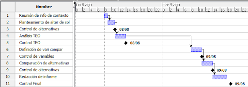

# Universidad Tecnológica Nacional - Facultad Regional Buenos Aires
## Análisis de Sistemas - 2022

* **Curso:** K2102
* **Jefe de Cátedra:** Darío Piccirilli
* **Profesor:** Diego Schmidt
* **Ayudantes:** Rodrigo Putrino, Luciana Bertolani

---

### Trabajo Práctico Integrador N°3: Estudio de Factibilidad

* **Fecha Estipulada de 1° Entrega:** 16/08
* **Fecha Real de Entrega:** 13/09
* **N° de Versión de la Entrega:** 2
* **Grupo N°4**

| Alumno | Legajo |
| :--- | :--- |
| LUCAS EIKI ARAKAKI JAHANA | 1722499 |
| JOAQUÍN CARRIQUIRY CASTRO | 2026703 |
| DANIEL COLQUI HUANCA | 1768967 |
| PATRICIO LIONEL GARCÍA | 2036563 |
| MELINA PAOLA LOZA FLORES | 1687645 |

---

## Índice
1. [Objetivo del documento](#objetivo-del-documento)
2. [Alcance de la etapa](#alcance-de-la-etapa)
3. [Planificación](#planificación)
   * [Diagrama de Gantt](#diagrama-de-gantt)
   * [Tabla de especificaciones](#tabla-de-especificaciones)
4. [Desarrollo](#desarrollo)
   * [Información de contexto](#información-de-contexto)
   * [Alternativas de Solución](#alternativas-de-solución)
   * [Comparación entre alternativas seleccionadas](#comparación-entre-alternativas-seleccionadas)
5. [Conclusión](#conclusión)
6. [Sugerencias](#sugerencias)
7. [Glosario](#glosario)

---

## Objetivo del documento 
El presente documento pretende representar el resultado del Estudio de Factibilidad realizado en la Organización MEGALABS durante el mes de agosto de 2022 en el contexto del proyecto de desarrollo del Sistema de registro de las visitas por parte de los Visitadores Médicos al laboratorio.

---

## Alcance de la etapa
En esta etapa de Estudio de Factibilidad se realizará un análisis y estudio de diferentes alternativas de solución para la problemática en cuestión, teniendo en cuenta los requerimientos establecidos en las etapas previas. 

A su vez, se efectuará un análisis TEO (Técnico, Económico y Operativo) de cada una de estas alternativas para conocer si es técnicamente posible, económicamente conveniente y operativamente viable su implementación. Finalmente, se efectuará una comparación entre las diferentes alternativas que hayan sobrepasado con éxito el análisis TEO, para así poder recomendar al cliente aquella que se considere óptima.

---

## Planificación
En esta tercera etapa de estudio de factibilidad iniciaremos con una corta reunión entre los participantes del proyecto en la cual terminaremos de definir las restricciones o condiciones a tener en cuenta para el desarrollo del producto. 

Una vez terminada la reunión, procederemos con el planteamiento de distintas alternativas de soluciones que se adapten adecuadamente a la problemática, para luego evaluar cada una de ellas con el análisis TEO y descartar las que no sean factibles.

Terminado el análisis TEO, continuaremos con la comparación de alternativas definiendo las variables a comparar, sus respectivos valores de ponderación y asignando las puntuaciones correspondientes. Concluiremos con la redacción del informe con la sugerencia final.

### Diagrama de Gantt

### Tabla de especificaciones

| Código | Nombre | Duración | Inicio | Terminado | Predecesores |
| :---: | :--- | :---: | :---: | :---: | :---: |
| 1 | Reunión de info de contexto | 1:00 | 08/08/22 08:00 | 08/08/22 09:00 | - |
| 2 | Planteamiento de alter de sol | 2:00 | 08/08/22 09:00 | 08/08/22 11:00 | 1 |
| 3 | Control de alternativas | 0:00 | 08/08/22 11:00 | 08/08/22 11:00 | - |
| 4 | Análisis TEO | 3:00 | 08/08/22 11:00 | 08/08/22 14:00 | 2 |
| 5 | Control TEO | 0:00 | 08/08/22 14:00 | 08/08/22 14:00 | - |
| 6 | Definición de vari compar | 3:00 | 09/08/22 08:00 | 09/08/22 11:00 | 4 |
| 7 | Control de variables | 0:00 | 09/08/22 11:00 | 09/08/22 11:00 | - |
| 8 | Comparación de alternativas | 3:00 | 09/08/22 11:00 | 09/08/22 14:00 | 6 |
| 9 | Control de alternativas | 0:00 | 09/08/22 14:00 | 09/08/22 14:00 | - |
| 10 | Redacción de informe | 4:00 | 09/08/22 14:00 | 09/08/22 18:00 | 8 |
| 11 | Control Final | 0:00 | 09/08/22 18:00 | 09/08/22 18:00 | - |

---

## Desarrollo

### Información de contexto
* **Fecha de inicio:** El desarrollo del proyecto comenzará el 01/09/2022.
* **Presupuesto máximo:** 2.000 USD para el desarrollo inicial y 100 USD/mes para mantenimiento.
* **Plazo de puesta en marcha:** Máximo 15 días para funcionalidades críticas (almacenamiento) y 15 días adicionales para el procesamiento de la información.
* **Compatibilidad de navegadores:** Google Chrome y Microsoft Edge.
* **Restricción de acceso:** Únicamente el Gerente de Sistemas y el encargado del llenado de planillas.
* **Almacenamiento:** No local, debe alojarse en un servicio externo.

---

### Alternativas de Solución

#### Alternativa 1: Servicios de Google
* **Descripción:** Utilización de Google Workspace (Forms, Sheets y Apps Script) para automatizar el almacenamiento de respuestas. Procesamiento de datos mediante Python ejecutado en Google Colaboratory.
* **Plataforma tecnológica:** Hardware básico. Plan *Business Standard* de Google Workspace para seguridad y almacenamiento.
* **Alcance funcional:** Formulario de visitas, envío automático a hojas de cálculo, registro ordenado en Google Sheets y procesamiento analítico en Google Colab.
* **Costo:** 
  * 15 hs Experto Google / Líder: $55 USD/h
  * 12 hs Semi-Sr Apps Script: $30 USD/h
  * 2 hs/mes Semi-Sr Data Scientist: $35 USD/h
  * Google Workspace: $10.8 USD/usuario/mes
  * **Costo Total:** 1.185 USD + 35 USD/mes + 10.8 USD/usuario/mes
* **Puesta en producción estimada:** 10/08/2022
* **Análisis TEO:**
  * **Técnico (OK):** Infraestructura y seguridad de Google.
  * **Económico (OK):** Dentro del presupuesto inicial.
  * **Operativo (OK):** Personal capacitado, pero baja flexibilidad por dependencia de terceros.

#### Alternativa 2: Node.js con MongoDB
* **Descripción:** Desarrollo de la interfaz web en React.js y servidor en Node.js. Almacenamiento en base de datos NoSQL MongoDB (estructuras BSON). Exportación a software específico para procesamiento.
* **Plataforma tecnológica:** Servidores o entornos para Node.js y plan Serverless en MongoDB Atlas.
* **Alcance funcional:** Formularios dinámicos customizados, transferencia a NoSQL y exportación para análisis.
* **Costo:**
  * 20 hs Líder / Experto Node & Mongo: $60 USD/h
  * 16 hs Semi-Sr Node.js: $30 USD/h
  * 2 hs/mes Data Scientist: $35 USD/h
  * Mongo Serverless (mantenimiento estimado): $10 USD/mes
  * **Costo Total:** 1.680 USD + 45 USD/mes
* **Puesta en producción estimada:** 20/08/2022
* **Análisis TEO:**
  * **Técnico (OK):** Alta escalabilidad horizontal y vertical.
  * **Económico (OK):** Dentro del presupuesto (1.680 USD < 2.000 USD).
  * **Operativo (OK):** Equipo capacitado y adaptable al cambio.

#### Alternativa 3: Django con AWS
* **Descripción:** Framework Django (Python) para backend y formularios, integrado con Amazon Redshift (Data Warehouse SQL) que incluye herramientas de Machine Learning.
* **Plataforma tecnológica:** Entorno Python/Django y servicios cloud en AWS (Amazon Redshift).
* **Alcance funcional:** Formulario web, almacenamiento relacional optimizado para analítica y procesamiento de gran volumen de datos.
* **Costo:**
  * 10 hs Experto Django / AWS (Líder): $65 USD/h
  * 8 hs Experto AWS Redshift: $40 USD/h
  * Amazon Redshift (Almacenamiento/ML): $10 USD/mes
  * **Costo Total:** 970 USD + 10 USD/mes
* **Puesta en producción estimada:** 15/08/2022
* **Análisis TEO:**
  * **Técnico (OK):** Recursos y servicios totalmente disponibles en la nube.
  * **Económico (OK):** Muy bajo costo (970 USD), excelente retorno de inversión.
  * **Operativo (OK):** Alta adaptabilidad por similitud de procesos.

#### Alternativa 4: Web3 con NLP y Smart Contracts
* **Descripción:** Sistema de reconocimiento de voz utilizando el módulo Natural (NLP en Node.js) para suplantar formularios. Almacenamiento descentralizado mediante Smart Contracts en la blockchain de Ethereum (web3.js).
* **Plataforma tecnológica:** Entorno Node.js con procesamiento de audio e integración a Ethereum.
* **Alcance funcional:** Reconocimiento de voz para resumir visitas, contratos inteligentes y almacenamiento blockchain.
* **Costo:**
  * 15 hs Experto Node/Web3: $60 USD/h
  * 10 hs Experto Solidity: $45 USD/h
  * 5 hs Experto NLP: $35 USD/h
  * 2 hs/mes Data Scientist: $35 USD/h
  * Ejecución Smart Contracts (150 transacciones/día): ~$94 USD/mes
  * **Costo Total:** 1.525 USD + 129 USD/mes
* **Puesta en producción estimada:** 30/08/2022
* **Análisis TEO:**
  * **Técnico (OK):** Descentralizado y seguro.
  * **Económico (OK):** Dentro del rango inicial, pero costo mensual ajustado al límite.
  * **Operativo (NOK):** Rechazo de los usuarios por desconfianza en Smart Contracts y alta complejidad de mantenimiento.

#### Resumen del Análisis TEO

| Análisis | Alt. 1 (Google) | Alt. 2 (Node + Mongo) | Alt. 3 (Django + AWS) | Alt. 4 (Web3 + NLP) |
| :---: | :---: | :---: | :---: | :---: |
| **Técnico (T)** | OK | OK | OK | OK |
| **Económico (E)** | OK | OK | OK | OK |
| **Operativo (O)** | OK | OK | OK | **NOK** |

---

### Comparación entre alternativas seleccionadas

#### Ponderación de Variables

* **Coste económico (10%):** Eficiencia en costo inicial y mantenimiento.
* **Puesta en marcha (25%):** Rapidez para desplegar el sistema (prioridad máxima por urgencia).
* **Soporte (7%):** Disponibilidad y resolución de problemas durante horario laboral.
* **Flexibilidad (5%):** Facilidad de adaptar el código a futuros cambios.
* **Performance (15%):** Velocidad de respuesta y guardado.
* **Seguridad (8%):** Protección de acceso a datos.
* **Escalabilidad (12%):** Capacidad para aumentar el volumen de datos/usuarios.

#### Criterios de Calificación (Escala 1 a 5)

* **Coste Económico:** 1 (≥2000 USD) a 5 (100-500 USD)
* **Puesta en Marcha:** 1 (>24 días) a 5 (≤6 días)
* **Soporte:** 1 (1-2 hs) a 5 (≥16 hs / 24/7)
* **Flexibilidad:** 1 (25%) a 5 (99%)
* **Performance:** 1 (≥50s) a 5 (≤20s)
* **Seguridad:** 1 (20% riesgo) a 5 (1% riesgo)
* **Escalabilidad:** 1 (≤6000 usuarios) a 5 (≥15000 usuarios)

#### Matriz de Puntuaciones Directas

| Alternativa / Variable | Coste (10%) | Puesta en marcha (25%) | Soporte (7%) | Flexibilidad (5%) | Performance (15%) | Seguridad (8%) | Escalabilidad (12%) |
| :--- | :---: | :---: | :---: | :---: | :---: | :---: | :---: |
| **Alt. 1: Google** | 3 | 4 | 3 | 1 | 3 | 3 | 3 |
| **Alt. 2: Node + Mongo** | 2 | 2 | 5 | 5 | 3 | 4 | 2 |
| **Alt. 3: Django + AWS** | 4 | 3 | 4 | 5 | 4 | 5 | 5 |

#### Matriz Ponderada y Totales

| Alternativa | Coste | Puesta en marcha | Soporte | Flexibilidad | Performance | Seguridad | Escalabilidad | **TOTAL** |
| :--- | :---: | :---: | :---: | :---: | :---: | :---: | :---: | :---: |
| **Alt. 1: Google** | 0,30 | 1,00 | 0,21 | 0,05 | 0,45 | 0,24 | 0,36 | **2,61** |
| **Alt. 2: Node + Mongo** | 0,20 | 0,50 | 0,35 | 0,25 | 0,45 | 0,32 | 0,24 | **2,31** |
| **Alt. 3: Django + AWS** | 0,40 | 0,75 | 0,28 | 0,25 | 0,60 | 0,40 | 0,60 | **3,28** |

*(Nota: Puntuaciones finales consolidadas tras la aplicación de coeficientes de ponderación).*

---

## Conclusión
Se realizó el análisis de factibilidad evaluando cuatro alternativas mediante la metodología TEO. La Alternativa 4 (Web3) fue descartada en la fase operativa. 

Al comparar las tres opciones viables, la **Alternativa 3 (Django + AWS Redshift)** obtuvo el mayor puntaje general debido a su bajo costo de implementación, alta seguridad integrada, excelente rendimiento y escalabilidad nativa.

---

## Sugerencias
Recomendamos a **MEGALABS** la selección de la **Alternativa 3 (Django con AWS)**. 

Aporta el mejor balance financiero (costo total de 970 USD, muy por debajo del límite de 2.000 USD), cumple estrictamente con el tiempo de entrega previsto, garantiza la seguridad exigida por la gerencia y permite escalar el análisis de datos mediante Amazon Redshift sin inconvenientes a futuro.

---

## Glosario

* **Amazon Redshift:** Servicio de Data Warehouse administrado en la nube por Amazon Web Services.
* **Blockchain:** Cadena de bloques descentralizada y pública que registra transacciones mediante un libro contable compartido e inmutable.
* **Django:** Framework de desarrollo web en Python bajo el patrón Modelo-Vista-Controlador (MVC).
* **Google Workspace:** Suite de herramientas colaborativas bajo dominio personalizado.
* **Inteligencia Artificial:** Disciplina informática enfocada en emular procesos cognitivos humanos mediante algoritmos.
* **JavaScript:** Lenguaje de programación interpretado ampliamente utilizado en desarrollo web.
* **MongoDB:** Sistema de base de datos NoSQL orientado a documentos BSON.
* **Node.js:** Entorno de ejecución para JavaScript en el lado del servidor.
* **Python:** Lenguaje de programación de alto nivel enfocado en la legibilidad del código y análisis de datos.
* **Smart Contracts:** Contratos autoejecutables programados en una blockchain sin intermediarios.
