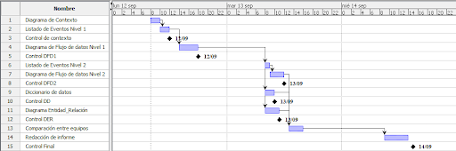
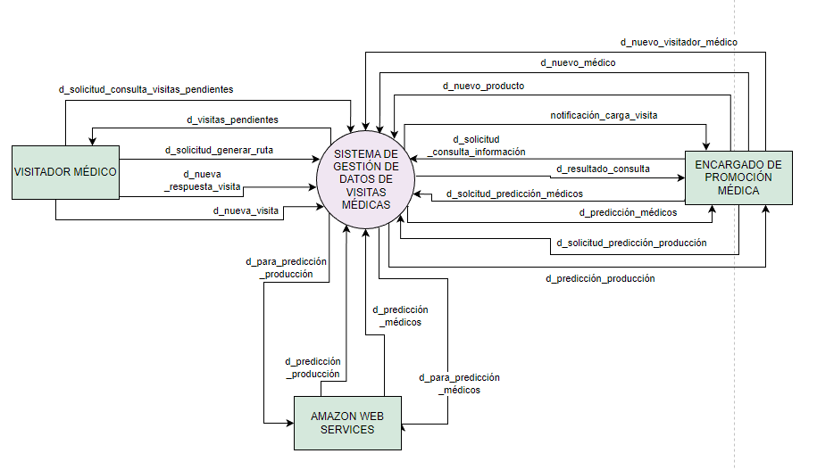

# Universidad Tecnológica Nacional - Facultad Regional Buenos Aires
## Análisis de Sistemas - 2022

* **Curso:** K2102
* **Jefe de Cátedra:** Darío Piccirilli
* **Profesor:** Diego Schmidt
* **Ayudantes:** Rodrigo Putrino, Luciana Bertolani

---

### Trabajo Práctico Integrador N°4: Análisis Estructurado

* **Fecha Estipulada de 1° Entrega:** 04/10/2022
* **Fecha Real de Entrega:** 03/10/2022
* **N° de Versión de la Entrega:** 1
* **Grupo N°4**

| Alumno | Legajo |
| :--- | :--- |
| LUCAS EIKI ARAKAKI JAHANA | 1722499 |
| JOAQUÍN CARRIQUIRY CASTRO | 2026703 |
| DANIEL COLQUI HUANCA | 1768967 |
| PATRICIO LIONEL GARCÍA | 2036563 |
| MELINA PAOLA LOZA FLORES | 1687645 |

---

## Índice
1. [Objetivo del documento](#objetivo-del-documento)
2. [Alcance de la etapa](#alcance-de-la-etapa)
3. [Planificación](#planificación)
   * [Diagrama de Gantt](#diagrama-de-gantt)
   * [Tabla de especificaciones](#tabla-de-especificaciones)
4. [Desarrollo](#desarrollo)
   * [Diagrama de contexto](#diagrama-de-contexto)
   * [Listado de Eventos Nivel 1](#listado-de-eventos-nivel-1)
   * [Diagrama flujo de datos nivel 1](#diagrama-flujo-de-datos-nivel-1)
   * [Listado de Eventos Nivel 2](#listado-de-eventos-nivel-2)
   * [Diccionario de datos](#diccionario-de-datos)
   * [Diagrama de Entidad-Relación](#diagrama-de-entidad-relación)
5. [Conclusión](#conclusión)
6. [Glosario](#glosario)

---

## Objetivo del documento 
El presente documento pretende representar el resultado del Análisis estructurado realizado en la Organización MEGALABS durante el mes de septiembre de 2022 en el contexto del proyecto de desarrollo del Sistema de registro de las visitas por parte de los Visitadores Médicos al laboratorio.

---

## Alcance de la etapa
En esta etapa de análisis estructurado, a partir de la alternativa seleccionada en la etapa previa, se establecerá qué es lo que realiza o deberá realizar el sistema sin importar de qué manera lo hace. 

Asimismo, permite definir un modelo lógico en el cual el enfoque utilizado es de tipo *Top Down*, es decir, realiza un análisis que parte de lo más general hacia lo particular. A través de las distintas herramientas que nos brinda el análisis estructurado, tales como el DC, DFD, DD y DER, podremos representar de forma gráfica esta etapa. Al finalizar, se efectuará y se verificará el correcto balanceo del DFD y DD con el DER.

---

## Planificación
En esta cuarta etapa de análisis estructurado del sistema comenzaremos realizando el Diagrama de Contexto del mismo con una corta reunión entre los participantes del proyecto. Una vez terminado el diagrama, procederemos con el planteamiento del listado de eventos de nivel 1 para luego realizar el Diagrama de Flujo de Datos (DFD). 

Una vez llegados a este punto, dividiremos al equipo en 3 partes para poder desarrollar el Diagrama de flujo de datos nivel 2, Diccionario de datos y el Diagrama de Entidad-Relación de manera paralela.

Terminados los 3 desarrollos, continuaremos con la comparación de resultados de cada uno para corregir incongruencias que hayan podido surgir. Por último, redactaremos el informe con toda la información importante sobre el análisis realizado.

### Diagrama de Gantt

### Tabla de especificaciones

| Código | Nombre | Duración | Inicio | Terminado | Predecesores |
| :---: | :--- | :---: | :---: | :---: | :---: |
| 1 | Diagrama de contexto | 1:00 | 12/09/22 08:00 | 12/09/22 10:00 | - |
| 2 | Listado de Eventos Nivel 1 | 2:00 | 12/09/22 10:00 | 12/09/22 12:00 | 1 |
| 3 | Control de contexto | 0:00 | 12/09/22 12:00 | 12/09/22 12:00 | - |
| 4 | Diagrama de Flujo de datos Nivel 1 | 3:00 | 12/09/22 14:00 | 12/09/22 18:00 | 2 |
| 5 | Control DFD1 | 0:00 | 12/09/22 18:00 | 12/09/22 18:00 | - |
| 6 | Listado de Eventos Nivel 2 | 3:00 | 13/09/22 08:00 | 13/09/22 09:00 | 4 |
| 7 | Diagrama de Flujo de datos Nivel 2 | 0:00 | 13/09/22 10:00 | 13/09/22 12:00 | 6 |
| 8 | Control DFD2 | 3:00 | 13/09/22 12:00 | 13/09/22 12:00 | - |
| 9 | Diccionario de datos | 0:00 | 13/09/22 08:00 | 13/09/22 10:00 | 4 |
| 10 | Control DD | 4:00 | 13/09/22 10:00 | 13/09/22 10:00 | - |
| 11 | Diagrama Entidad-Relación | 0:00 | 13/09/22 08:00 | 13/09/22 11:00 | 4 |
| 12 | Control DER | 0:00 | 13/09/22 11:00 | 13/09/22 11:00 | - |
| 13 | Comparación entre equipos | 3:00 | 13/09/22 13:00 | 13/09/22 16:00 | 7; 9; 11 |
| 14 | Redacción de informe | 5:00 | 14/09/22 09:00 | 14/09/22 14:00 | 13 |
| 15 | Control Final | 0:00 | 14/09/22 15:00 | 14/09/22 15:00 | - |

---

## Desarrollo

### Diagrama de contexto 

---

### Listado de Eventos Nivel 1
1. Ingresar nuevo visitador médico
2. Ingresar nuevo producto
3. Ingresar nuevo médico 
4. Ingresar nueva visita a realizar
5. Generar ruta de visita
6. Consultar visitas pendientes
7. Consultar visitas
8. Registrar nueva respuesta de una visita 
9. Evaluar visita
10. Obtener predicción médicos a visitar
11. Predicción de productos los cuales conviene aumentar producción

---

### Diagrama flujo de datos nivel 1 

---

### Listado de Eventos Nivel 2

* **Ingresar nuevo visitador médico**
* **Ingresar nuevo producto**
* **Ingresar nuevo médico**
* **Ingresar nueva visita a realizar**
* **Generar ruta de visita**
  * Solicitar generación de nueva ruta de visita
  * Buscar visitas pendientes y visitadores médicos disponibles
  * Elaborar una ruta de visita teniendo en cuenta locación y horarios
  * Almacenar nueva ruta de visita
* **Consultar visitas pendientes**
  * Solicitar información sobre visitas pendientes
  * Buscar visitas pendientes del visitador médico solicitante en su ruta actual
* **Consultar visitas**
  * Solicitar búsqueda de visitas
  * Ingresar filtros de búsqueda
  * Obtener información sobre las visitas, los productos promocionados y los médicos visitados según el filtro ingresado
  * Enviar resultado de la búsqueda al solicitante
* **Registrar nueva respuesta de una visita**
* **Evaluar visita**
  * Obtener información sobre la visita médica 
  * Calcular la valoración del resultado de una visita
  * Almacenar dicha valoración junto a su respectiva visita
* **Obtener predicción médicos a visitar**
  * Solicitar predicción
  * Obtener información sobre las visitas, sus resultados y los médicos visitados
  * Enviar información a Amazon Web Services
  * Almacenar predicción
* **Predicción de productos los cuales conviene aumentar producción**
  * Solicitar predicción
  * Obtener información sobre las visitas, sus resultados y los productos promocionados
  * Enviar información a Amazon Web Services
  * Almacenar predicción

---

### Diccionario de datos

#### Flujos de datos:
* **d_nuevaRespuesta** = `@id_visita_realizada` + `id_visita` + `nombre_visitador` + `id_visitador` + { `MÉDICO` + `PRODUCTOS` + (`MATERIAL_PROMOCIONAL`) + `fecha` + `hora` + `respuesta` + `valoración_calculada` }
* **d_nuevaVisitaPendiente** = `@id_visita` + `nombre_visitador` + `id_visitador` + `MÉDICO` + `PRODUCTOS` + `ESTADO`
* **d_nuevaRuta** = `@id_rutaDeVisita` + `nombre_visitador` + `id_visitador` + { `id_visita` + `MÉDICO` + `PRODUCTOS` } 
* **d_médicos** = `@id_medico` + `nombre_médico` + `especialidad` + `email` + `teléfono` + `DOMICILIO` + `prepaga` + `DOMICILIO_CONSULTORIO`
* **d_productos** = { `@id_producto` + `línea` + `nombre` + `especialidad` }

#### Estructura de datos:
* **MÉDICO** = `d_médicos`
* **PRODUCTOS** = `d_productos`
* **MATERIAL_PROMOCIONAL** = [ `"muestra"` | `"folleto"` | `"informe"` ] 
* **DOMICILIO** = `calle` + `altura` + (`piso` + `depto.`) + `cod_postal` + `provincia` + `municipio`
* **DOMICILIO_CONSULTORIO** = `DOMICILIO`
* **ESTADO** = [ `"Pendiente"` | `"Realizada"` ] 

#### Almacenamientos:
* **RESULTADOS_VISITAS** = `d_nuevaRespuesta`
* **VISITAS** = `d_nuevaVisitaPendiente`
* **MÉDICOS** = `d_médicos`

---

### Diagrama de Entidad-Relación 

---

## Conclusión
En esta etapa se ha llevado a cabo un análisis estructurado de la organización **MEGALABS** utilizando un modelo de enfoque *Top Down*. El uso de este tipo de enfoque nos permitió mejorar la interacción con la organización y proporcionar una forma de refinamiento estandarizada al mismo tiempo que se documenta.

En primera instancia, se confecciona el diagrama de contexto, en el cual se considera al sistema de gestión de datos de las visitas médicas como un único proceso. A continuación, se realiza el diagrama de flujo de datos de nivel 1 con su correspondiente lista de eventos, cuyo objetivo es mostrar cuáles son los procesos que componen el alcance funcional del sistema.

Finalmente, se realiza el diccionario de datos y el diagrama de entidad-relación, los cuales constituyen un modelo enfocado exclusivamente en la persistencia y flujo de la información.

El próximo paso a seguir consistirá en el análisis orientado a objetos, enfocándonos específicamente en el diseño e implementación de los casos de uso y diagramas UML.

---

## Glosario

* **Diagrama de contexto:** Representa la abstracción de más alto nivel del Sistema y define las entidades externas con las que interactúa, así como sus entradas y salidas.
* **Diagrama de flujo de datos (DFD):** Representa la descripción gráfica de los subsistemas lógicos que componen el sistema principal, sus movimientos y almacenes lógicos de datos.
* **Diccionario de datos (DD):** Listado ordenado alfabéticamente que describe todos los datos y estructuras que administra el sistema.
* **Diagrama Entidad-Relación (DER):** Representación mediante un modelo relacional/red de los datos almacenados o persistidos en el sistema y sus relaciones.