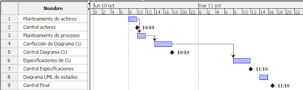
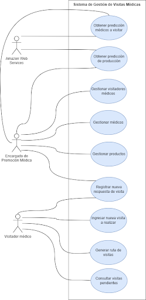
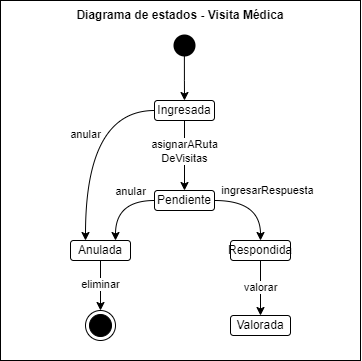

# Universidad Tecnológica Nacional - Facultad Regional Buenos Aires
## Análisis de Sistemas - 2022

* **Curso:** K2102
* **Jefe de Cátedra:** Darío Piccirilli
* **Profesor:** Diego Schmidt
* **Ayudantes:** Rodrigo Putrino, Luciana Bertolani

---

### Trabajo Práctico Integrador N°5: Análisis Orientado a Objetos

* **Fecha Estipulada de 1° Entrega:** 18/10
* **Fecha Real de Entrega:** 17/10
* **N° de Versión de la Entrega:** 1
* **Grupo N°4**

| Alumno | Legajo |
| :--- | :--- |
| LUCAS EIKI ARAKAKI JAHANA | 1722499 |
| JOAQUÍN CARRIQUIRY CASTRO | 2026703 |
| PATRICIO LIONEL GARCÍA | 2036563 |
| MELINA PAOLA LOZA FLORES | 1687645 |

---

## Índice
1. [Objetivo del documento](#objetivo-del-documento)
2. [Alcance de la etapa](#alcance-de-la-etapa)
3. [Planificación](#planificación)
   * [Diagrama de Gantt](#diagrama-de-gantt)
   * [Tabla de especificaciones](#tabla-de-especificaciones)
4. [Desarrollo](#desarrollo)
   * [Listado de Actores](#listado-de-actores)
   * [Diagrama de Casos de Uso](#diagrama-de-casos-de-uso)
   * [Especificaciones de Casos de Uso](#especificaciones-de-casos-de-uso)
   * [Diagrama UML de Estados](#diagrama-uml-de-estados)
5. [Conclusión](#conclusión)
6. [Glosario](#glosario)

---

## Objetivo del documento 
El presente documento pretende representar el resultado del Análisis orientado a objetos realizado en la Organización MEGALABS durante el mes de octubre de 2022 en el contexto del proyecto de desarrollo del Sistema de registro de las visitas por parte de los Visitadores Médicos al laboratorio.

---

## Alcance de la etapa
En esta etapa de Análisis orientado a objetos, a partir de la alternativa previamente seleccionada, se realizará su respectivo diagrama de casos de uso, sus especificaciones detalladas y una breve descripción de los actores involucrados. Adicionalmente, se construirá un diagrama UML de Estados para representar las transiciones que sufren las visitas médicas a lo largo de su ciclo de vida en el sistema.

---

## Planificación
En esta quinta etapa de análisis orientado a objetos se comenzará con la identificación y descripción de roles de los actores involucrados. Luego se confeccionará el diagrama de casos de uso del sistema definiendo los procesos y sus asociaciones. A continuación, se detallarán las especificaciones de cada caso de uso clave y, finalmente, se elaborará el diagrama UML de estados.

### Diagrama de Gantt

### Tabla de especificaciones

| Código | Nombre | Duración | Inicio | Terminado | Predecesores |
| :---: | :--- | :---: | :---: | :---: | :---: |
| 1 | Planteamiento de actores | 2:00 | 10/10/22 08:00 | 10/10/22 10:00 | - |
| 2 | Control actores | 0:00 | 10/10/22 10:00 | 10/10/22 10:00 | - |
| 3 | Planteamiento de procesos | 2:00 | 10/10/22 10:00 | 10/10/22 12:00 | 1 |
| 4 | Confección de Diagrama CU | 4:00 | 10/10/22 14:00 | 10/10/22 18:00 | 3 |
| 5 | Control Diagrama CU | 0:00 | 10/10/22 18:00 | 10/10/22 18:00 | - |
| 6 | Especificaciones de CU | 4:00 | 11/10/22 08:00 | 11/10/22 12:00 | 4 |
| 7 | Control Especificaciones | 0:00 | 11/10/22 12:00 | 11/10/22 12:00 | - |
| 8 | Diagrama UML de estados | 2:00 | 11/10/22 14:00 | 11/10/22 16:00 | - |
| 9 | Control Final | 0:00 | 11/10/22 16:00 | 11/10/22 16:00 | - |

---

## Desarrollo

### Listado de Actores

* **Visitador Médico (VM):** Profesional encargado de visitar los consultorios médicos y entregarles información sobre los nuevos productos de la industria farmacéutica o reforzar la permanencia de los que ya se comercializan.
* **Encargado de Promoción Médica (EPM):** Conoce a fondo el territorio y el target médico a alcanzar considerando el perfil del portafolio (indicaciones, precio) y planifica el plan de visitas médicas: mensaje para cada producto, muestras, material promocional de apoyo.
* **Amazon Web Services (AWS):** Plataforma en la nube. El Sistema de Gestión de Visitadores Médicos utiliza Amazon Redshift para el almacenamiento en la nube de los datos maestros y procesados, donde posteriormente son analizados e implementados para el desarrollo de predicciones mediante IA.

---

### Diagrama de Casos de Uso

---

### Especificaciones de Casos de Uso

#### CU 01 - Generar Ruta de Visitas
* **Historial de Revisiones:** Versión 1.0 - 15/10/2022 - Autor: Leandro Paredes
* **Actores involucrados:** VM (Visitador Médico)
* **Descripción:** Consiste en la generación de una ruta de visitas para un día específico. El sistema analiza las visitas a realizar persistidas, evaluando ubicación de consultorios, especialidades, área de traslado asignada y productos.
* **Disparador (Trigger):** Solicitud al sistema por parte del Visitador Médico.
* **Precondiciones:**
  1. Que exista al menos una visita a realizar registrada en el sistema.
  2. Que el VM exista en el sistema.
* **Camino básico:**
  1. El VM solicita la generación de la ruta de visitas.
  2. El Sistema busca aquellas visitas sin realizar asociadas al VM solicitante.
  3. El Sistema reordena dichas visitas según la ubicación (y horario prefijado si aplica).
  4. El Sistema reúne la información de las visitas obtenidas en un informe.
  5. El Sistema retorna al VM dicho informe.
* **Postcondiciones:** Disponibilidad de consultar las visitas pendientes en la ruta generada.
* **Excepciones:** No se encuentra ninguna visita registrada en el sistema.
* **Requisitos complementarios:** Rendimiento: velocidad de 1 min por visita asociada. Frecuencia esperada: cada 20 días hábiles.

---

#### CU 02 - Ingresar nueva visita a realizar
* **Historial de Revisiones:** Versión 1.0 - 15/10/2022 - Autor: Julián Alvarez
* **Actores involucrados:** VM (Visitador Médico)
* **Descripción:** Ingreso de una nueva visita a realizar consultando información persistida del VM, médico y productos a promocionar.
* **Disparador (Trigger):** El VM ingresa una nueva visita a realizar.
* **Precondiciones:**
  1. Que el VM se encuentre registrado.
  2. Que el médico se encuentre registrado.
  3. Que los productos se encuentren registrados.
* **Camino básico:**
  1. El VM ingresa los datos de la nueva visita (Nombre médico, Domicilio, Especialidad).
  2. El Sistema consulta las visitas asociadas al VM, al médico y a los productos ingresados.
  3. Si no detecta visitas similares en un margen menor a una semana, almacena la visita.
* **Postcondiciones:** La visita queda registrada y lista para ser incluida en una ruta.
* **Excepciones:**
  * a. VM no registrado.
  * b. Médico no registrado.
  * c. Productos no registrados.
  * d. Existe una visita similar registrada en menos de una semana.

---

#### CU 03 - Registrar nueva respuesta de visita
* **Historial de Revisiones:** Versión 1.0 - 15/10/2022 - Autor: Emiliano Martínez
* **Actores involucrados:** VM (Visitador Médico), EPM (Encargado de Promoción Médica)
* **Descripción:** Registro de la respuesta de una visita realizada mediante un formulario. La respuesta se almacena asociada a la visita y el sistema calcula su valoración.
* **Disparador (Trigger):** El VM registra la respuesta de una visita.
* **Precondiciones:** Que exista una visita pendiente en la ruta de visitas del VM.
* **Camino básico:**
  1. El VM completa el formulario (Nombre médico, Fecha, Hora, Comentarios, Resultado).
  2. La respuesta se almacena asociada a la visita.
  3. El Sistema evalúa la respuesta de la visita y calcula su valoración.
  4. La valoración es almacenada junto a la visita y su respuesta.
* **Postcondiciones:** Respuesta y valoración almacenadas.
* **Excepciones:** No existe ninguna visita pendiente en la ruta del VM.
* **Requisitos complementarios:** Duración máxima de 5 minutos por visita.

---

#### CU 04 - Obtener predicción de médicos a visitar
* **Historial de Revisiones:** Versión 1.0 - 15/10/2022 - Autor: Alejandro Gómez
* **Actores involucrados:** EPM (Encargado de Promoción Médica), AWS (Amazon Web Services)
* **Descripción:** Recopila información de visitas, resultados y médicos para enviarla a AWS Redshift. AWS procesa la predicción de recomendación de visitas y genera un informe para el EPM.
* **Disparador (Trigger):** Solicitud de predicción realizada por el EPM.
* **Precondiciones:** Al menos un médico y una visita registrados en el sistema.
* **Camino básico:**
  1. El EPM solicita la predicción de médicos a visitar.
  2. El sistema consulta médicos, visitas realizadas, resultados y valoraciones.
  3. La información es enviada a AWS.
  4. AWS confecciona la predicción con sus modelos de IA.
  5. El sistema almacena la predicción y genera el informe para el EPM.
* **Postcondiciones:** Predicción registrada y disponible.
* **Excepciones:**
  * a. No hay visitas registradas.
  * b. No hay médicos registrados.
* **Requisitos complementarios:** Rendimiento máximo de 1 minuto por cada visita/médico procesado.

---

#### CU 05 - Gestionar médicos
* **Historial de Revisiones:** Versión 1.0 - 15/10/2022 - Autor: Giovani Lo Celso
* **Actores involucrados:** EPM (Encargado de Promoción Médica)
* **Descripción:** Permite registrar, editar y organizar en el sistema la información de los médicos y sus hábitos de prescripción.
* **Disparador (Trigger):** Ingreso de datos por parte del EPM.
* **Camino básico:**
  1. El EPM ingresa a "Gestionar médicos".
  2. El Sistema muestra el listado existente.
  3. El EPM selecciona "Agregar médico" e ingresa los datos (Nombre, Especialidad, Email, Teléfono, Domicilio, Prepaga).
  4. El Sistema verifica que no exista duplicación.
  5. Por cada producto recetado, el EPM ingresa datos del producto (Nombre, Línea, Cantidad).
  6. El Sistema registra al Médico.
* **Caminos alternativos (Editar):**
  * c.1. El EPM selecciona "Editar médico", modifica los campos necesarios y el Sistema valida que no existan datos redundantes.
* **Excepciones:** Médico o datos editados ya existentes en el Sistema.

---

### Diagrama UML de Estados

Representación del ciclo de vida y los cambios de estado de una **Visita Médica**:

* **Transiciones de estado:**
  * `[Inicio]` ➔ **Ingresada**
  * **Ingresada** ➔ `asignarARutaDeVisitas` ➔ **Pendiente**
  * **Ingresada** / **Pendiente** ➔ `anular` ➔ **Anulada** ➔ `eliminar` ➔ `[Fin]`
  * **Pendiente** ➔ `ingresarRespuesta` ➔ **Respondida**
  * **Respondida** ➔ `valorar` ➔ **Valorada**

---

## Conclusión
En esta etapa se completó el análisis orientado a objetos utilizando UML como estándar de modelado. El Diagrama de Casos de Uso y sus especificaciones permitieron definir claramente las interacciones entre los actores (Visitador Médico, Encargado de Promoción y AWS) y el sistema. 

Por su parte, el Diagrama de Estados brindó visibilidad sobre el ciclo de vida de la entidad central del dominio (*Visita Médica*), desde su creación (*Ingresada*) hasta su resolución final (*Valorada* o *Anulada*). Con este documento se da por finalizada la fase de análisis del proyecto MEGALABS.

---

## Glosario

* **Precondición:** Condición obligatoria que debe cumplirse antes de iniciar la ejecución de un caso de uso o bloque de código.
* **Postcondición:** Condición lógica que el sistema garantiza que se cumplirá inmediatamente después de ejecutar con éxito una operación.
* **Trigger (Disparador):** Evento o acción que inicia la ejecución de un caso de uso.
* **UML (Unified Modeling Language):** Lenguaje unificado de modelado estandarizado para visualizar, especificar, construir y documentar artefactos de sistemas de software orientados a objetos.
