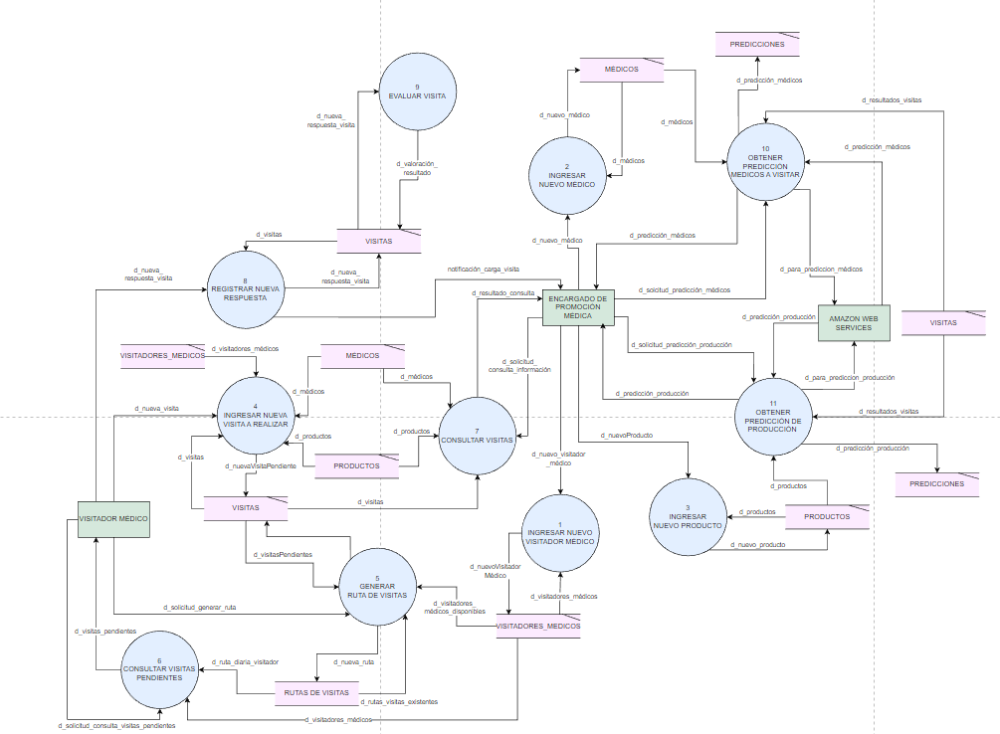
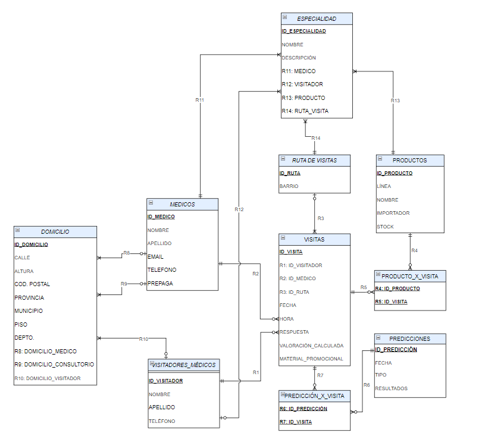

# Sin título

# Análisis y Rediseño de Sistema de Información — Megalabs S.A.

> **Proyecto de Análisis de Sistemas — UTN FRBA**
> 
> 
> Documentación técnica formal del relevamiento, evaluación de factibilidad y modelado de procesos para la automatización del registro de visitas médicas en **Megalabs S.A.**.
> 

---

## Objetivo del Proyecto

Optimizar y automatizar el circuito de registro de visitadores médicos en la organización, reduciendo la carga operativa manual en planillas y los costos administrativos asociados.

---

## Entregables y Documentación Técnica

Podés revisar la documentación detallada por etapa en los siguientes documentos:

- [📄 01 - Estudio Preliminar](01-Estudio-Preliminar.md): Contexto organizacional, organigrama y alcance.
- [📄 02 - Relevamiento](02-Relevamiento): Minutas de entrevista, procesos AS-IS y matriz de información.
- [📄 03 - Estudio de Factibilidad TEO](03-Estudio-de-Factibilidad): Evaluación Técnica, Económica y Operativa de alternativas.
- [📄 04 - Análisis Estructurado](04-Análisis-Estructurado): DFD Nivel 1 y 2, Diccionario de Datos y DER.
- [📄 05 - Análisis Orientado a Objetos](05-Análisis-Orientado-a-Objetos): Casos de Uso, Actores y Diagramas UML.

---

## Diagramas de Arquitectura y Procesos

### *1. Diagrama de Flujo de Datos (DFD Nivel 1)*

### *2. Modelo Entidad-Relación (DER)*

---

## Competencias Aplicadas

- **Modelado de Procesos:** Análisis Estructurado (DFD, DED) y Orientado a Objetos (UML, Casos de Uso).
- **Evaluación de Factibilidad:** Análisis TEO (Técnico, Económico, Operativo) y matriz de ponderación.
- **Documentación Técnica:** Especificación formal de requerimientos en Markdown.
